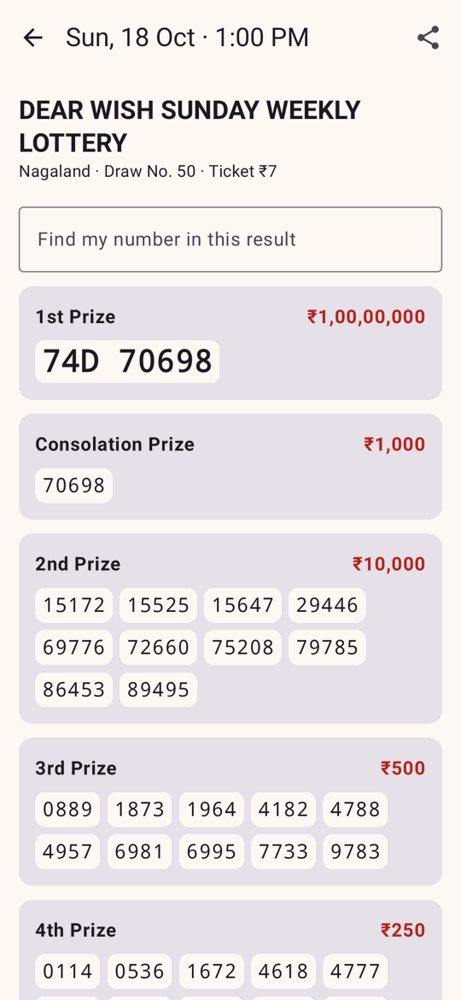
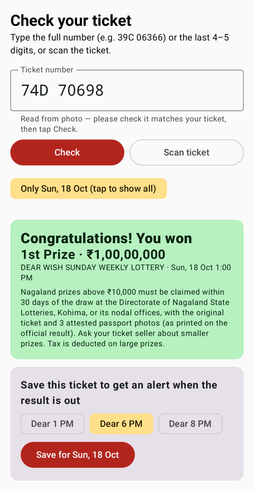

# LottoDost (가칭): 인도 Dear 로또 결과 앱 프로토타입

인도 Google Play용 **로또 결과 확인 앱**입니다. 판매 기능은 없고 결과만 보여줍니다.
Nagaland State Lottery(1 PM · 8 PM · Dear Laxmi)를 중심으로 Sikkim 6 PM 추첨까지 한 화면에서 보여줍니다.
티켓 번호를 입력하거나 **카메라·사진으로 스캔**하면 당첨 여부를 바로 알려줍니다.

| 오늘 결과 | 상세 | 당첨 확인 | 스캔 결과 |
|---|---|---|---|
|  |  |  |  |

스크린샷은 2026-10-18의 **실제 추첨 결과**를 JVM(Robolectric)에서 렌더링한 것입니다. 힌디어·벵골어 화면은 `docs/screenshots/05`, `06`에 있습니다.

## 구조

```
lotterysambad.com (텍스트 PDF, 추첨 후 ~10분) ─┐
                                               ├─ pipeline/ (Python, GitHub Actions cron)
nagalandlotteries.com (공식 스캔 PDF, ~20:30)  ─┘     · 파싱 → 구조 검증 → 교차검증
                                                      · data 브랜치에 v1/latest.json 게시
                                                              │ (raw.githubusercontent CDN, jsDelivr 미러)
                                                              ▼
                                       android/ (Kotlin + Jetpack Compose 앱)
                                       · 오프라인 캐시, ETag 조건부 요청
                                       · ML Kit 온디바이스 OCR로 티켓 스캔
                                       · 저장한 티켓 자동 확인 + 알림 (추첨 시각에 맞춰 WorkManager 실행)
```

**잘못된 번호를 보여주는 것이 늦게 보여주는 것보다 나쁘다**는 원칙으로 설계했습니다.

- 번호는 OCR이 필요 없는 텍스트 PDF에서만 가져옵니다.
- 등수별 개수, 자릿수, 중복, 정렬 순서, 날짜, "위로상 = 1등의 끝 5자리" 규칙을 검사합니다. 하나라도 어긋나면 게시하지 않습니다.
- 공식 관보 OCR 결과와 일치하면 **Verified** 배지를 붙입니다. 불일치하면 경고를 남겨 사람이 확인하게 합니다.

## 실행

```bash
# 파이프라인 (poppler-utils 필요, 공식 OCR에는 tesseract-ocr + pillow 추가)
cd pipeline && python -m pytest -q tests
python -m lottery_pipeline.build --out ../public          # 실제 사이트에서 수집

# 앱 (JDK 17+, Android SDK 36)
cd android && ./gradlew testDebugUnitTest -Proborazzi.test.record=true assembleRelease
```

## 데이터 게시를 켜려면

`results.yml`의 schedule은 **기본 브랜치(main)에 머지된 뒤에만** 동작합니다. 머지 후 Actions 탭에서 `results` 워크플로를 한 번 수동 실행하면 `data` 브랜치가 생성되고, 앱이 그 JSON을 읽어 옵니다.

자세한 리서치·정책·리스크는 [docs/RESEARCH.md](docs/RESEARCH.md)를 보세요.
