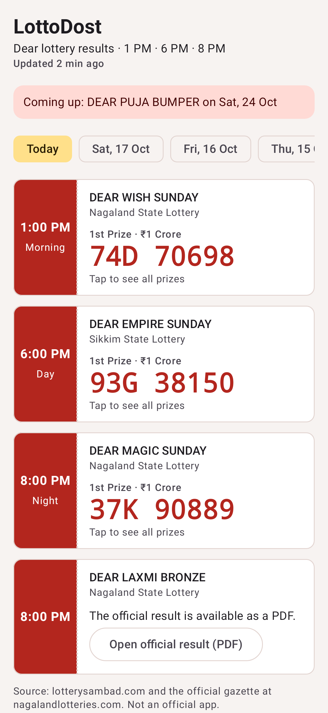
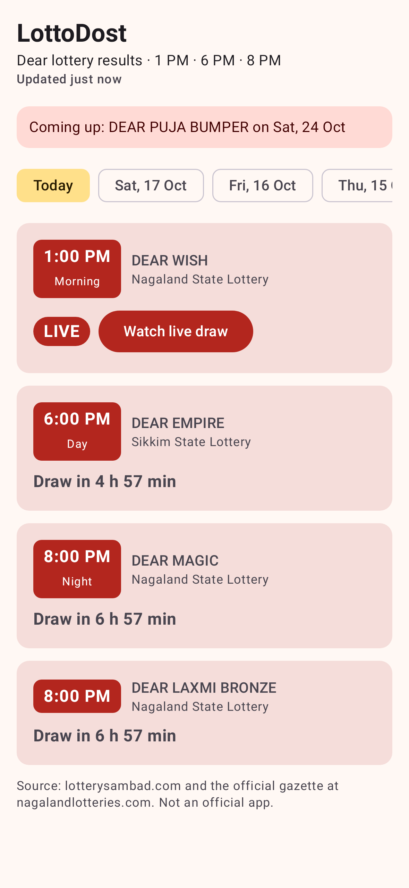
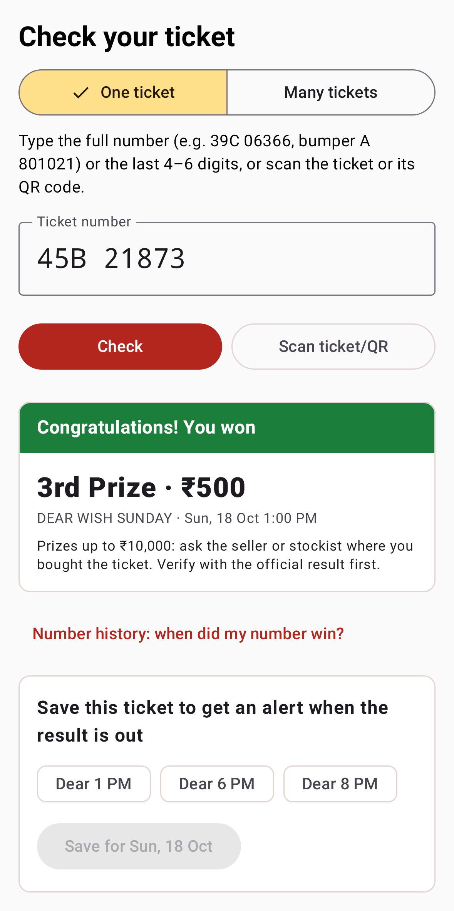
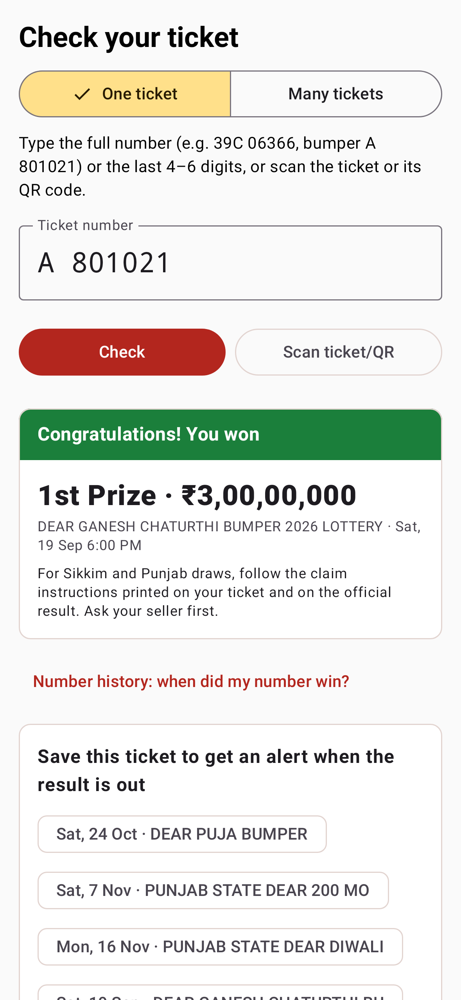
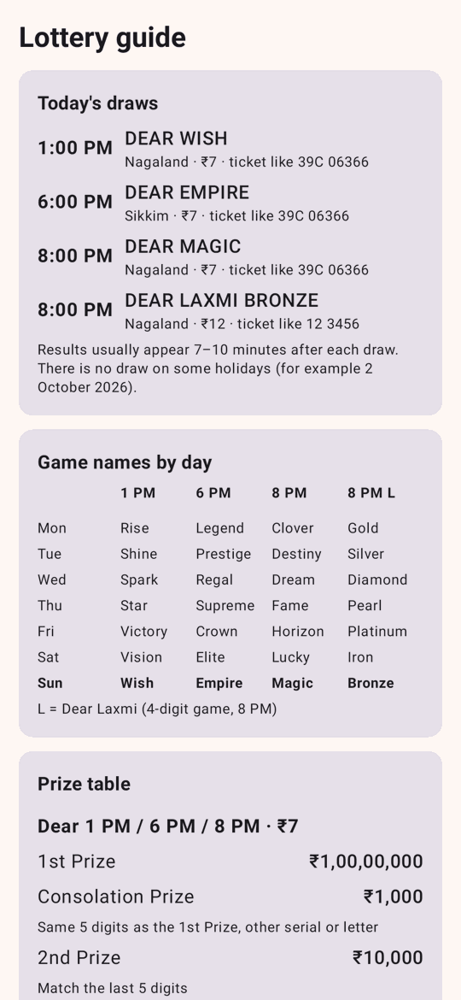
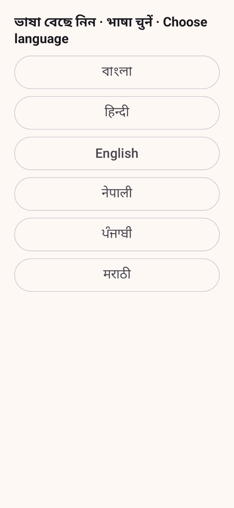

# LottoDost (가칭): 인도 Dear 로또 결과 앱

인도 Google Play용 **로또 결과·당첨 확인 앱**입니다. 판매 기능은 없습니다.

- Nagaland State Lottery(1 PM · 8 PM · Dear Laxmi), Sikkim 6 PM, 범퍼·월간 추첨을 한 화면에 보여줍니다.
- 티켓 번호를 입력하거나 **카메라·사진으로 티켓 번호 또는 QR 코드를 스캔**하면 당첨 여부를 바로 알려줍니다.
- 지원 언어: English · हिन्दी · বাংলা · नेपाली · ਪੰਜਾਬੀ · मराठी
  - 직역 대신 실제 구매자들이 쓰는 말로 현지화했습니다(예: "इनाम लगा", "লটারি লেগেছে", "ਇਨਾਮ ਨਿਕਲਿਆ", "बक्षीस लागले").

| 오늘 결과 | 라이브 추첨 | 당첨 확인 | 범퍼 당첨 | 가이드 | 언어 선택 |
|---|---|---|---|---|---|
|  |  |  |  |  |  |

스크린샷은 2026-09-19~10-18의 **실제 추첨 결과**를 JVM(Robolectric)에서 렌더링한 것입니다. 다크 모드, 200% 글씨, 벵골어·펀자브어 화면은 `docs/screenshots/`에 있습니다.

## 구조

```
lotterysambad.com 텍스트 PDF (추첨 후 ~10분, 과거 ~30일) ─┐
nagalandlotteries.com 공식 스캔 PDF (~20:30 IST)          ─┤ pipeline/ (Python, GitHub Actions cron)
                                                          │  파싱 → 구조 검증 → 공식 관보 OCR 대조 → 정적 JSON
                                                          ▼
          data 브랜치: v2/today.json · latest.json · days/ · index.json · config.json
                                                          │
          GitHub Pages ──┬── jsDelivr ──┬── raw.githubusercontent (인도 ISP 실측 순서)
                         │  (향후 Cloudflare 자체 도메인을 config.json으로 맨 앞에 추가)
                         ▼
          android/ (Kotlin + Jetpack Compose, minSdk 24, targetSdk 36, APK 2.9MB)
          오프라인 캐시 · ETag · 미러 자동 전환 · 결과 대기 중에만 지터 폴링 · ML Kit 온디바이스 OCR
```

**설계 원칙:** 잘못된 번호는 늦은 번호보다 나쁩니다.
- 번호는 텍스트 PDF에서만 읽습니다.
- 개수·자릿수·중복·정렬·날짜 중 하나라도 어긋나면 게시하지 않습니다.
- 공식 관보와 1·2등이 일치하면 **Verified** 표시를 붙입니다.

## 문서

| 문서 | 내용 |
|---|---|
| [docs/REVIEW.md](docs/REVIEW.md) | **전체 보완 검토 보고서**: 인도 접속 실측, 피크 시뮬레이션, 고친 버그, 경쟁 앱 비교, 법률 |
| [docs/RESEARCH.md](docs/RESEARCH.md) | 추첨 사실관계(원본 확인), 상금 구조, Play 정책, 경쟁 앱 |
| [docs/PLAY_LAUNCH.md](docs/PLAY_LAUNCH.md) | 스토어 제목·설명(글자 수 검증), Data safety, 콘솔 체크리스트, 수익화 주의 |
| [docs/OPERATIONS.md](docs/OPERATIONS.md) | 처음 설정, 범퍼 당일 절차, 호스팅 이전 |
| [docs/privacy.html](docs/privacy.html) | 개인정보처리방침 (Pages로 배포됨) |
| [web/](web/) | 결과 웹페이지 (Pages 루트 `index.html`). 문구는 앱 번역을 그대로 사용 |
| [dist/](dist/) | 미리보기 APK (디버그 키 서명, 테스트용) |

## 실행

```bash
# 파이프라인 (poppler-utils 필요, OCR 검증에는 tesseract-ocr + pillow)
cd pipeline && python -m pytest -q tests                      # 126 tests (실제 결과지 102개 포함)
python -m lottery_pipeline.build --out ../public --backfill-days 30 --deep

# 부하 모델 / 인도 접속 측정
python loadsim/simulate.py
python loadsim/reachability.py https://entrepreneur123.github.io/india/v2/today.json

# 앱 (JDK 17+, Android SDK 36)
cd android && python3 tools/check_translations.py
./gradlew testDebugUnitTest -Proborazzi.test.record=true lintRelease assembleRelease   # 54 tests
```

## 데이터 게시를 켜려면

`docs/OPERATIONS.md`의 "처음 한 번" 절차를 따르세요. 요약하면 다음 두 가지입니다.
1. Actions에서 `results` 워크플로를 수동 실행합니다(backfill 30).
2. Settings → Pages에서 `data` 브랜치를 배포 대상으로 지정합니다.
