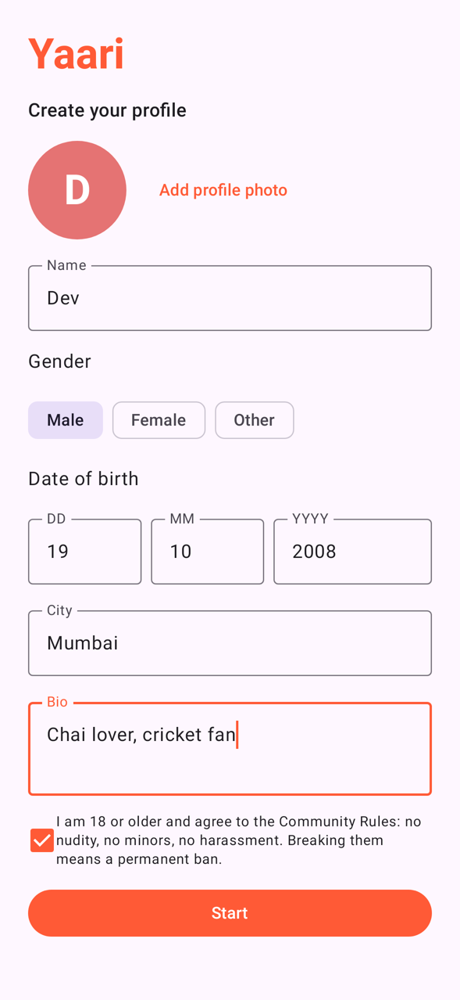
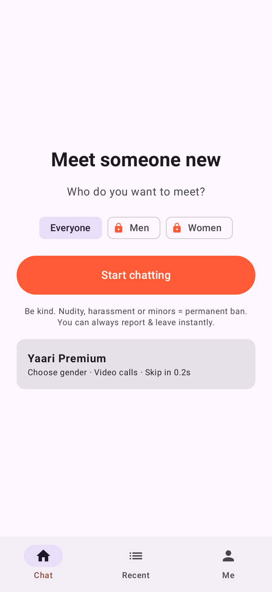
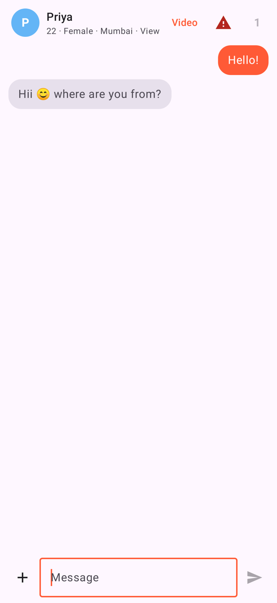
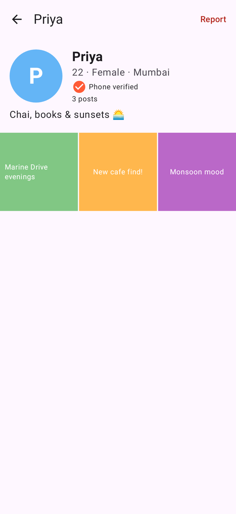
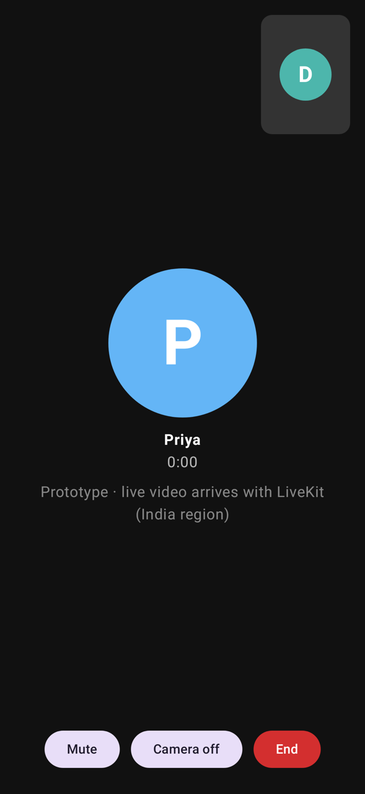
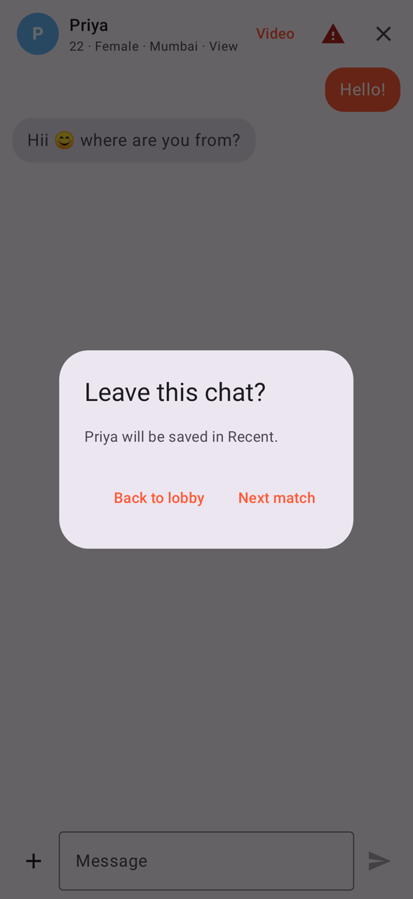
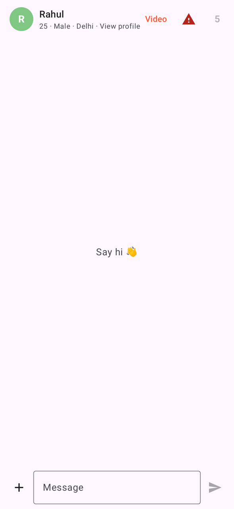
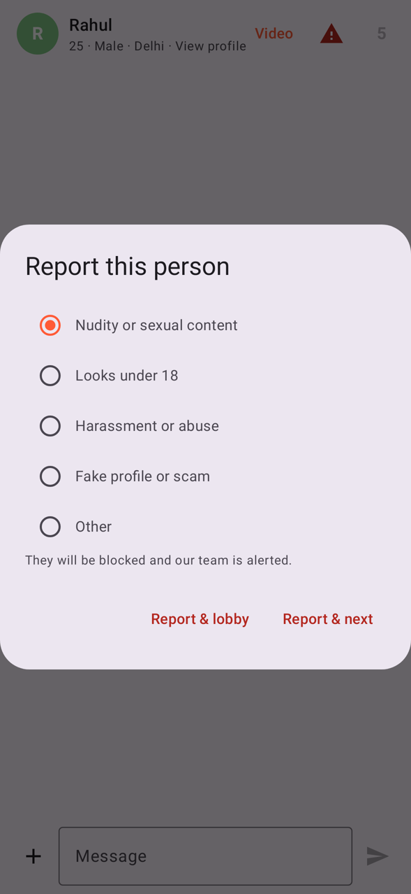
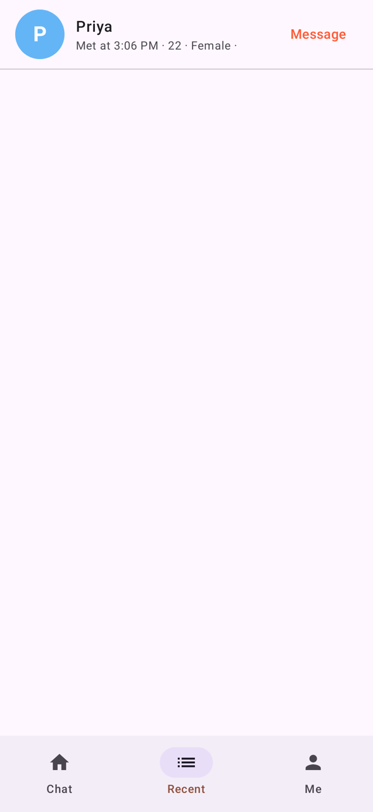
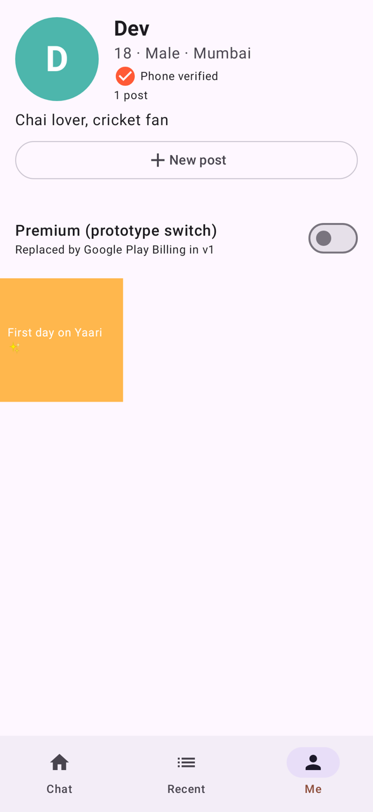

# Yaari (가칭) — 인도 랜덤채팅 앱 프로토타입

로또 앱(`/android`)과 **완전히 분리된 독립 프로젝트**입니다. 이 폴더만 떼어 새 저장소로 옮겨도 그대로 빌드됩니다.

- 설치 파일: [`dist/yaari-prototype.apk`](dist/yaari-prototype.apk) (1.5MB, 디버그 키 서명)
  - 폰에서 내려받아 열고 "알 수 없는 앱 설치"를 허용하면 설치됩니다.
- 서버 없이 폰 안에서만 돌아가는 **가짜 백엔드**(`FakeBackend`)로 동작합니다.
  - 상대 12명, 자동 답장, 영상통화 수락·거절, 상대가 나가는 상황까지 흉내 냅니다.
  - 앱을 끄면 데이터가 초기화됩니다.
- 인증번호(OTP)는 `123456`입니다.
- Premium은 "Me" 탭의 스위치로 켜고 끕니다. 실제 결제는 일어나지 않습니다.

## 화면

| 가입 | 로비 | 채팅 | 상대 프로필 | 영상통화 |
|---|---|---|---|---|
|  |  |  |  |  |

| 나가기 선택 | 무료: 5초 잠금 | 신고 | 최근 만난 사람 | 내 프로필 |
|---|---|---|---|---|
|  |  |  |  |  |

스크린샷은 테스트(`AppFlowTest`)가 실제 앱 화면을 JVM에서 처음부터 끝까지 조작하면서 찍은 것입니다.

## 구현된 기능

| 기획 | 프로토타입 동작 |
|---|---|
| 휴대폰 인증, 번호 하나당 계정 하나 | 인도 번호(6~9로 시작하는 10자리)만 받습니다. 같은 번호로 다시 가입하면 기존 계정으로 로그인됩니다 |
| 18세 이상만 | 생년월일로 만 나이를 계산합니다. 18세 생일 전날까지는 가입할 수 없습니다 |
| 프로필 (성별·나이·사진·피드) | 사진 선택(권한 불필요한 Photo Picker), 인스타식 3열 피드, 게시물 작성 |
| 랜덤 매칭 + 상대 프로필 표시 | 채팅방 상단에 상대 사진·나이·성별·도시가 뜨고, 누르면 피드가 열립니다 |
| 성별 선택은 유료 | 무료는 "Everyone"만 가능. 남/여 선택은 결제 안내 화면으로 연결됩니다 |
| 사진·동영상 전송 | 갤러리에서 골라 보낼 수 있습니다 |
| 영상통화 (구독자만, 상대 수락) | 요청 → 상대 수락/거절 → 통화 화면. 실제 영상은 v2에서 LiveKit으로 연결합니다 |
| 나가기 잠금 | 무료 5초, 유료 0.2초 동안 X 버튼에 남은 초가 표시됩니다. 서버 측(ViewModel)에서도 막혀 있습니다 |
| 나가기 후 두 가지 선택 | "로비로" / "다음 매칭" |
| **신고하고 나가기** | 잠금과 상관없이 **항상 즉시**. 신고하면 차단되고, 다시 매칭되지 않으며, 최근 목록에서도 빠집니다 |
| 최근 만난 기록 → 메시지 | Recent 탭에서 다시 대화하거나 신고할 수 있습니다 |
| 화면 캡처 차단 | 채팅·영상·상대 프로필 화면에서는 스크린샷과 녹화가 막힙니다 (FLAG_SECURE) |
| 늦게 온 답장 처리 | 방을 나간 뒤 이전 상대의 답장이 새 대화방에 섞이지 않습니다 |

## 구조

```
app/src/main/kotlin/com/yaari/chat/
  model/Models.kt        데이터 모델
  domain/Rules.kt        나가기 잠금 시간, 전화번호·나이 검증 (순수 로직, 테스트 대상)
  data/Backend.kt        서버 인터페이스 ← v1에서 실제 구현으로 교체
  data/FakeBackend.kt    프로토타입용 가짜 서버
  ui/AppViewModel.kt     앱 상태와 규칙 (화면은 상태만 그림)
  ui/*Screen.kt          화면들 (Jetpack Compose)
```

`Backend` 인터페이스 하나만 갈아 끼우면 실제 서버로 넘어가도록 설계했습니다.

- 로그인: Firebase Phone Auth
- 채팅: Firestore (오프라인 저장과 재전송 내장)
- 매칭: Cloud Run + Redis 대기열
- 영상: **LiveKit Cloud (인도 리전: 뭄바이·남인도)**
- 결제: Google Play Billing

## 검증

```
./gradlew testDebugUnitTest -Proborazzi.test.record=true lintRelease assembleRelease
```

- 테스트 19개 통과.
  - 규칙 7개, ViewModel 11개, 전체 UI 흐름 1개.
  - UI 흐름 테스트: 가입 → 18세 미만 거부 → 18세 가입 → 유료 성별 선택 → 매칭 → 채팅 → 상대 프로필 → 영상통화 → 나가기 → 최근 → 메시지 → 무료 잠금 → 신고 → 게시물 작성.
- Lint 오류 0개. 경고는 라이브러리 새 버전 안내와 백업 속성 하나뿐입니다.
- 실기기·에뮬레이터 테스트는 아직 하지 않았습니다. 이 개발 환경에는 가상화(KVM)가 없어서 에뮬레이터를 실행할 수 없습니다.

## 프로토타입의 한계 (v1에서 할 일)

- 서버가 없습니다. 실제 사용자끼리는 연결되지 않습니다.
- 영상통화는 화면만 있습니다(LiveKit 연동 전).
- UI는 영어만 지원합니다. 힌디어 등은 `strings.xml`로 옮기면서 추가합니다.
- 신고는 차단까지만 됩니다. 실제 서비스에서는 다음이 필요합니다.
  - 신고가 서버 검수 대기열로 들어가고, 2시간 안에 자동 조치
  - 사진·영상 AI 검사
- 출시 전에 바꿀 것:
  - 서명 키(지금은 디버그 키)
  - 개인정보처리방침
  - 고충처리 담당자(Grievance Officer) 공개
  - Play Console 18+ 설정
